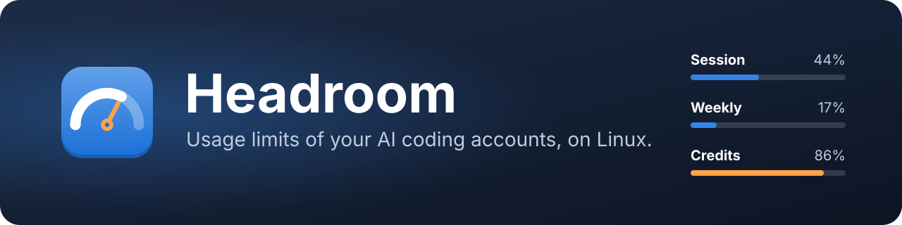
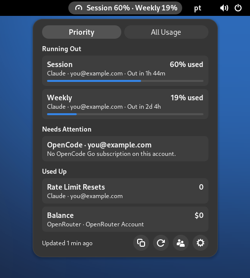
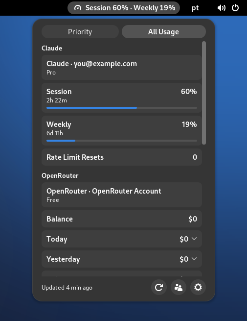
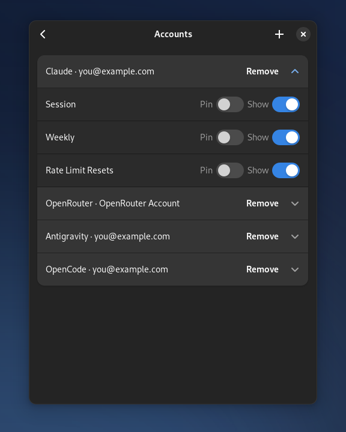

Headroom shows how much of each AI plan you've used: session and weekly limits, credits, and balances, in
one GTK4 panel, with the limits closest to running out in the tray or the GNOME Shell top bar. It supports
Claude, ChatGPT, Cursor, Amp, Antigravity, Copilot, Devin, Grok, Muse Code, Ollama, OpenCode, OpenRouter, and
Z.ai, plus the logins of a [CLIProxyAPI](https://github.com/router-for-me/CLIProxyAPI) server.

Inspired by [OpenUsage](https://github.com/robinebers/openusage) by Robin Ebers.

<p>
  
  
  
</p>

## Install

Download the `.deb` or the AppImage from [GitHub Releases](https://github.com/williancima/headroom/releases).

- **.deb**: `sudo apt install ./headroom_*.deb`. It also installs the GNOME Shell extension system-wide.
- **AppImage**: `chmod +x Headroom-x86_64.AppImage` and run it. It uses the GTK4 and libadwaita of your system
  (GNOME 46 or later). On start it installs the GNOME Shell extension in your user folder and writes the
  `headroom` command the extension needs to `~/.local/bin`. It also updates itself; see
  [docs/updates.md](docs/updates.md).

The first time it runs with the extension installed, the app turns the extension on. Log out and back in once
so GNOME loads it. Until then the app runs with its panel only. Details in
[docs/gnome-extension.md](docs/gnome-extension.md).

## Build from source

On Ubuntu:

```sh
sudo apt install libgtk-4-dev libadwaita-1-dev pkg-config
cargo build --release
```

This builds two binaries in `target/release/`:

- `headroom-app`: the background app with the tray icon and the panel.
- `headroom`: the [command line](docs/cli.md).

Put both on your `PATH` (for example in `~/.local/bin`) and run `headroom-app`. Add accounts from the panel's
Accounts screen or with `headroom accounts add <provider>`. Credentials are kept in the Secret Service, so a
keyring such as GNOME Keyring must be running.

Open **Settings** from the panel to change the refresh interval, the warning and critical thresholds, a proxy,
launch at login, and a keyboard shortcut that toggles Headroom. Desktop notifications for limits running
low are available. The Priority tab and any usage breakdown can be copied as an image. See
[docs/settings.md](docs/settings.md) and [docs/notifications.md](docs/notifications.md).

## GNOME Shell extension

On GNOME Shell 46 to 51, an extension puts the same limits in the top bar, with a dropdown for Priority and
All Usage. See [docs/gnome-extension.md](docs/gnome-extension.md) to install it.

## Command line

`headroom` adds accounts, fetches usage, and prints it as JSON. See [docs/cli.md](docs/cli.md).

```sh
headroom accounts add claude
headroom usage --refresh
```

## Documentation

How everything works is in [docs/](docs/README.md).

## License

[MIT](LICENSE). Parts of the provider logic come from OpenUsage (MIT); the license file keeps both copyright
lines.
